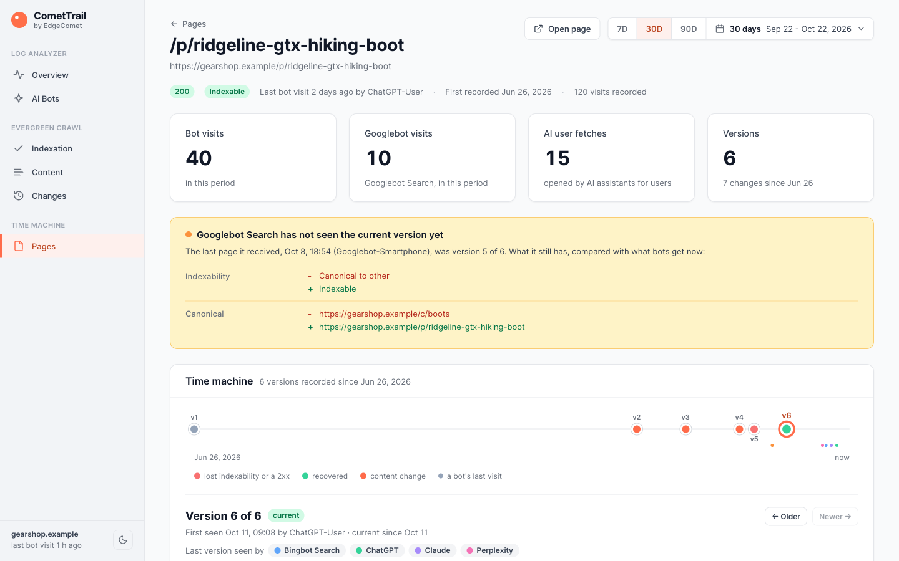
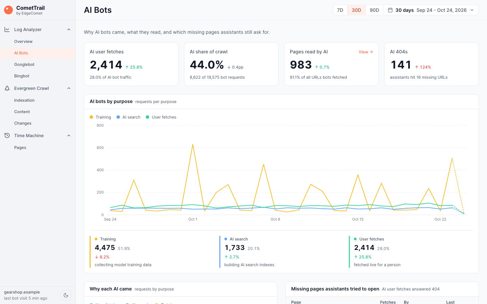

# CometTrail by EdgeComet

An evergreen crawl for your own site, on Cloudflare's free tier.

CometTrail watches Googlebot, Bingbot, GPTBot, ClaudeBot, PerplexityBot and the other search and AI bots as they crawl your site. For every visit it stores the log line and the page the bot received: status, speed, title, meta description, canonical, robots directives, headings, hreflang and structured data. The result is a site audit you never have to run, and a history of every page as bots saw it.



## Why an evergreen crawl

A site crawler shows you what your crawler sees. A log file shows that Googlebot fetched a URL and got a 200, but not what was on the page. CometTrail records both, from the bots' own visits:

- **No crawl to run.** Nothing to schedule, no crawl load on your origin, no stale export. The data updates with every bot visit and is freshest where bots return most.
- **A time machine.** Every visit is kept, so you can open any URL and see each version bots received, when it changed, and which version each bot saw last. A fix is done when Googlebot has fetched it, and CometTrail shows you when that happened.
- **Automatic comparison.** Every report compares the period with the one before: which pages lost indexability, which got it back, which release changed canonicals on 80 pages.
- **AI bots by purpose.** Training crawls, AI search crawls and live fetches that an assistant makes for a person are counted apart and set next to Googlebot.

Read more in [Evergreen Crawl: A New Way to See Your Site Through Googlebot's Eyes](https://edgecomet.com/blog/evergreen-crawl-a-new-way-to-see-your-site-through-googlebots-eyes/).

## Try it locally in one minute

You need Node.js 18 or newer. No Cloudflare account is needed for this step.

```bash
git clone https://github.com/EdgeComet/comet-trail.git
cd comet-trail
make dev
```

Open <http://localhost:8788>. `make dev` installs dependencies, creates a local database (Wrangler's local D1), fills it with 120 days of bot visits to a demo outdoor store at `gearshop.example`, and starts the dashboard. Nothing touches a remote database.

The demo data follows a few stories you can look for:

| Where to look | What you will find |
|---|---|
| Pages > `/p/ridgeline-gtx-hiking-boot` | A release broke its canonical 18 days ago and was fixed 12 days ago. Bingbot and the AI bots have fetched the fix; Googlebot has not. |
| Indexation | `/c/sleeping-bags` and its products went `noindex` three days ago, a staging setting that leaked to production. |
| Indexation > Canonical Analysis | The trekking poles category moved to `/c/hiking-poles` seven days ago and its old URL answers 301, but its filter and sort URLs still name the old URL as their canonical: canonicals that point to a redirect. |
| Content | A release five days ago dropped the product name from the headlamp title template: every headlamp page bots fetched since then shares "Headlamps \| GearShop", and the H1 already tells them apart. Also sold-out products that answer 200 with "Product not found", new tents launched with "Lorem ipsum" descriptions, and a sale banner in the jackets H1. |
| Changes | The canonical bug and its fix, a title template rollout, guides that lost their H1. The biggest events also stand as dashed lines on the Bot Activity, Indexability over time and Response Status Codes charts: the canonical bug in red, its fix in green. |
| AI Bots | AI assistants fetching pages for people, more each week, and still asking for products the store no longer sells. |
| Log Analyzer > Status Codes | A three-hour outage 15 days ago: a day with 503s and unanswered requests, and Googlebot crawling less for the two days after. Ten discontinued products that answered 404 and now redirect, which AI assistants still fetch, and long-dead products that still answer 404, six of them still recommended by assistants. |
| Log Analyzer > Loading Time | Internal search pages are the slowest section at 0.8-1.5 s, filter URLs are slower than product pages, and the outage answered in 3-9 s before Googlebot backed off. |

`make seed` regenerates the data (`SEED=` changes the randomness, `SCALE=2` doubles the traffic). `make help` lists every target.

## What you get



| Report | Answers |
|---|---|
| **Log Analyzer > Overview** | How much did each bot family crawl, and which changes did bots find on many pages at once (dashed lines on the chart)? How much of Googlebot's crawl landed on indexable pages (crawl efficiency: the share of Googlebot Search requests that received a page Google can index), and did the rest go to canonicalized or noindex pages, redirects or errors? Which status codes and response times did all bots, Googlebot or the AI bots get (a switch on each of the two cards), and what did the newest visits receive? |
| **Log Analyzer > Status Codes** | What did Googlebot, the AI bots or all bots get back (one switch for the tab, Googlebot first), day by day, per status code and per section, against the previous period, and which status code changes did the site make? Which URLs answer 404, 410, 5xx or nothing, since when, what did they answer before, and do AI assistants still ask for them? Which redirecting URLs do bots keep fetching? |
| **Log Analyzer > Loading Time** | How fast did the origin answer (the median, the 95th percentile and the share of requests that took 1 s or longer), did the crawl fall off after slow days, and which sections and URLs are slowest? |
| **Log Analyzer > AI Bots** | Why did each AI come (training, AI search, a live fetch for a person), which sections does each read compared with Googlebot, and which missing pages are assistants still asking for? |
| **Evergreen Crawl > Indexation** | Which pages can be indexed, judged from the page bots received, and which changed verdict since the previous period? How did the verdicts move day by day (each day counts the pages bots fetched in as many days up to it as the period has), next to the changes to status codes, robots tags and canonicals that moved them? Where do the canonicals that point to another URL lead: to indexable pages, or to redirects, errors, noindex pages and chains? |
| **Evergreen Crawl > Content** | Which titles, meta descriptions and H1s of indexable pages are missing, duplicated or too long in words, which titles and descriptions run past the 60 and 160 characters search results usually show (counted beside the verdicts, which stay word-based), why each duplicate group happens and what would tell its pages apart, which pages got a worse verdict since the previous period, how each title matches its H1, and which pages carry placeholder text or read as "not found"? Every figure opens the pages behind it. |
| **Evergreen Crawl > Changes** | Every change bots saw, dated by the first visit that showed it, grouped into release-sized events. The biggest events also stand as dashed lines on the Overview, Indexation and Status Codes charts: red when most of their changes cost pages their indexability or their 2xx, green when they gave it back. |
| **Pages** | Every URL bots fetched. Each opens its time machine: versions, what changed, which version each bot saw last, and the visit log. |

Every report reads the period in the header: the last 24 hours, 7, 14, 30 or 90 days, or a custom range of up to 365 days. Change figures compare it with the period of the same length just before. The period is kept in the address bar (`?period=7d`, `?period=2026-09-01_2026-09-30`), so a reload or a shared link opens the same view. Days are UTC, like the charts. Light and dark themes are in the sidebar.

## How it works

```
Bot request ──► Cloudflare edge ──► [Worker] ──► your origin
                                       │  ▲
                                       │  │ response
                                       ▼  │
                                tee the response body
                                       │
                         ┌─────────────┴─────────────┐
                         ▼                           ▼
                  back to the bot             HTMLRewriter reads the
                  (no added latency)          SEO fields, D1 INSERT in
                                              ctx.waitUntil
```

- **`worker/`** is the collector, a Cloudflare Worker on your site's routes. Human visitors pass straight through. When a known bot asks for an HTML page, the worker returns the origin's response unchanged and, after the response is on its way, parses the page and appends one row to D1.
- **`dashboard/`** is a Cloudflare Pages app that reads the same D1 database: static frontend in `public/`, one API endpoint per report in `functions/api/`.
- **`shared/`** holds the bot catalog and the indexability rule, used by both, and by the demo seed.

### What each visit records

| Field | Source |
|---|---|
| `url`, `ts` | the request, and when the worker captured it |
| `bot_name` | the matching entry in [`shared/bots.js`](shared/bots.js) |
| `status`, `response_time_ms` | the origin's response (`NULL` status when the origin was unreachable) |
| `title`, `meta_description`, `canonical` | `<title>`, `<meta name="description">`, `<link rel="canonical">` |
| `meta_robots`, `meta_googlebot` | robots directives, as lists |
| `h1`, `h2` | heading texts |
| `hreflangs` | `<link rel="alternate" hreflang>` pairs |
| `structured_data_types` | every JSON-LD `@type` |
| `index_status` | `indexable`, `non_200`, `blocked_by_meta` or `non_canonical` |

The full schema is in [`schema.sql`](schema.sql); ready-made SQL for common questions is in [`docs/queries.md`](docs/queries.md).

### Bots

[`shared/bots.js`](shared/bots.js) lists the tracked bots, groups them into the families the charts draw (Googlebot Search, Bingbot Search, ChatGPT, Claude, Perplexity, Meta AI, Other) and tags each AI bot with its purpose:

| Purpose | Bots |
|---|---|
| User fetches (an assistant fetching a page for a person) | ChatGPT-User, Claude-User, Perplexity-User, Meta-ExternalFetcher, MistralAI-User |
| AI search (building an AI search index) | OAI-SearchBot, Claude-SearchBot, PerplexityBot, Meta-WebIndexer, MistralAI-Index |
| Training (collecting model training data) | GPTBot, ClaudeBot, Meta-ExternalAgent, CCBot, Bytespider, MistralAI-Training |

Add a bot by adding one line to that file; the collector, the reports and the demo data all pick it up.

## Install on your site

You need a Cloudflare account (the free plan is enough) with the domain you want to track on Cloudflare.

### With Claude Code (recommended)

Open this repository in [Claude Code](https://claude.com/claude-code) and run:

```
/install
```

It sets everything up from **one** Cloudflare API token: creates the D1 database, fills in both `wrangler.toml` files, picks your domain and wires the worker routes, applies the schema, deploys, and checks that a bot visit is actually recorded. It can also lock the dashboard behind Cloudflare Access (email login), including the parts that normally need clicking through the Zero Trust dashboard.

The only manual step is creating the token. At <https://dash.cloudflare.com/profile/api-tokens>, choose **Create Token > Create Custom Token** and add:

| Permission | Scope | Needed for |
|---|---|---|
| Workers Scripts · Edit | Account | deploy the worker |
| Workers Routes · Edit | Zone | bind the worker to your domain |
| D1 · Edit | Account | create and query the database |
| Cloudflare Pages · Edit | Account | deploy the dashboard |
| Zone · Read | Zone | find your domain |
| Account Settings · Read | Account | resolve your account |
| Access: Apps and Policies · Edit | Account | *(only to lock the dashboard)* |
| Access: Organizations, IdPs, and Groups · Edit | Account | *(only to lock the dashboard)* |
| DNS · Edit | Zone | *(only to lock the dashboard)* |

Paste the token when `/install` asks. Never commit it or paste it into a file: it is held in memory during the run only, and you can revoke it afterwards.

Not using Claude Code? The same steps run as `npm run setup -- <verb>` (the verbs are listed in `scripts/ct-install.mjs`), or follow [`docs/manual-setup.md`](docs/manual-setup.md) to do it by hand.

### Check that it works

Visit your site as a bot, then open the dashboard:

```bash
curl -A "Googlebot/2.1" https://your-domain.com/
npm run db:recent      # the newest rows, from the terminal
```

A normal browser visit adds no row: only bot user agents are recorded. Until the first visit arrives, the dashboard shows what to do next instead of empty charts. `npm run tail` streams the worker's logs while you wire the route.

### Locking the dashboard

`/install` asks whether to lock the dashboard behind Cloudflare Access, and locking is the recommended answer. The middleware in `dashboard/functions/_middleware.js` enforces login once the `CF_ACCESS_*` `[vars]` hold real values, which also covers the raw `*.pages.dev` URL and preview deployments. Until then the dashboard is public. Access needs a custom domain on a zone in your account, since it cannot sit in front of `*.pages.dev`. The manual steps are in [`docs/manual-setup.md`](docs/manual-setup.md#locking-the-dashboard-behind-cloudflare-access).

### Updating an existing install

After pulling a new version, re-apply the schema (`npm run db:init`; it is idempotent and drops indexes the current version no longer uses), then deploy both parts (`npm run deploy:worker`, `npm run deploy:dashboard`).

## Cloudflare free plan limits

D1's free plan allows 100,000 rows written and 5 million rows read per day, and 500 MB per database ([D1 pricing](https://developers.cloudflare.com/d1/platform/pricing/)). For CometTrail that means:

- **Writes.** Each bot visit writes about 3 rows: the visit and one entry in each of its two indexes, so the free plan records roughly 30,000 bot visits a day. Past a daily limit, D1 returns errors until the reset at 00:00 UTC ([D1 FAQ](https://developers.cloudflare.com/d1/reference/faq/)): the worker keeps serving your pages normally but records nothing, and the dashboard cannot load. The limits count every D1 database in the account.
- **Reads.** D1 counts every row a query reads, and a query that sorts or compares visits reads each one more than once, so a view reads several times the visits in its period. Each chart reads the selected period, most also the comparison period. The Indexation trend reads the period before as well, so that every day counts a full period of visits. Changes also looks up each page's last visit in the 30 days before the period through the url index, a few rows per page, to compare its first visit with, and the change markers on the Overview, Indexation and Status Codes charts come from that same read: it runs once per period, however many of these views you open. Status Codes and Loading Time read the history of the URLs they list through the url index, a few rows each, and a bot switch reads its cards again for each group you pick. Opening the pages behind a Content figure reads the period again, for each page of the list. Measured on the demo data (about 675 bot visits a day), a 30-day view reads: Overview 479,000 rows, Indexation 1.4 million, Status Codes 167,000, Loading Time 461,000, Content 242,000, AI Bots 211,000 and Pages 1.8 million. The change events, read once for Changes and the markers together, add 202,000 (48,000 for 7 days, 575,000 for 90 days). A 7-day view reads about a quarter of its 30-day figure: the 7-day Overview with its markers reads 160,000 rows, the 7-day Indexation with its markers 393,000. Reads grow with the visits: on a site with 10,000 bot visits a day, a 30-day Overview with its markers reads about 10 million rows, more than the free plan's 5 million a day, and a 7-day one about 2.4 million. Responses are cached in the browser for five minutes, so a reload costs nothing. On a busy site, use the 7-day views: one load of the 7-day Overview stays under the free plan's daily reads up to about 20,000 bot visits a day, one of the 7-day Indexation up to about 8,000. Every view you open counts against the same 5 million a day, so to open several reports a day on a busy site, move to the Workers Paid plan (25 billion rows read a month included).
- **CPU.** Workers on the free plan get 10 ms of CPU time per request ([Workers limits](https://developers.cloudflare.com/workers/platform/limits/)). The Content report grades every page in the dashboard's function rather than in D1, at roughly 7 ms per 1,000 URLs bots fetched in the period (our measurement in Node.js, both periods included). Above about 1,000 URLs in the period it can fail with error 1102, "Worker exceeded resource limits": choose a shorter period, or move to the Workers Paid plan (30 seconds of CPU per request).
- **Storage.** A visit takes about 0.7 KB with its index entries (measured on the demo data), so 500 MB holds roughly 700,000 visits. Rows are never deleted; add a scheduled cleanup if that matters for your site.

## What is deliberately left out

- **Bot verification.** Bots are matched by user agent only, so a scraper that claims to be Googlebot is counted as Googlebot. Verifying against the IP ranges each operator publishes, or a reverse DNS check, would close that gap.
- **JavaScript rendering.** The worker records the HTML your origin sends, not the page a bot renders after running JavaScript. Most AI bots do not run JavaScript either, so for them this is exactly what they get; for Googlebot on a client-rendered site the content may be thinner than what Google indexes.
- **Search Console data.** Impressions and clicks are not joined to pages.
- **Non-HTML resources.** robots.txt, sitemaps, images, CSS and JS are passed through but not recorded.
- **Pages no bot visits.** CometTrail does not crawl. A page shows up once a bot requests it.

[EdgeComet](https://edgecomet.com/evergreen-crawl/) adds JavaScript rendering, IP-verified bots and Search Console data to the same kind of reports. CometTrail is the small, readable version you can run and change yourself.

## Files

```
.
├── shared/                    used by the worker, the dashboard and the seed
│   ├── bots.js                bot catalog: user agents, families, AI purposes
│   └── seo.js                 the indexability rule
├── worker/src/index.js        the collector
├── dashboard/
│   ├── public/                the frontend (no build step)
│   │   ├── js/core/           router, period, providers, DOM helpers
│   │   ├── js/charts/         chart components (billboard.js)
│   │   ├── js/pages/          one module per report
│   │   └── vendor/            billboard.js and the Inter font, so it works offline
│   ├── functions/api/         one endpoint per report (Pages Functions)
│   ├── functions/_middleware.js   optional Cloudflare Access lock
│   └── lib/                   shared API helpers, SQL fragments, page history, content grading
├── scripts/
│   ├── ct-install.mjs         installer verbs behind /install
│   └── seed-demo.mjs          the demo store's data
├── schema.sql                 the crawls table and its indexes
├── docs/                      sample queries, manual setup, screenshots
└── .claude/commands/install.md    the /install flow
```

## License

MIT
